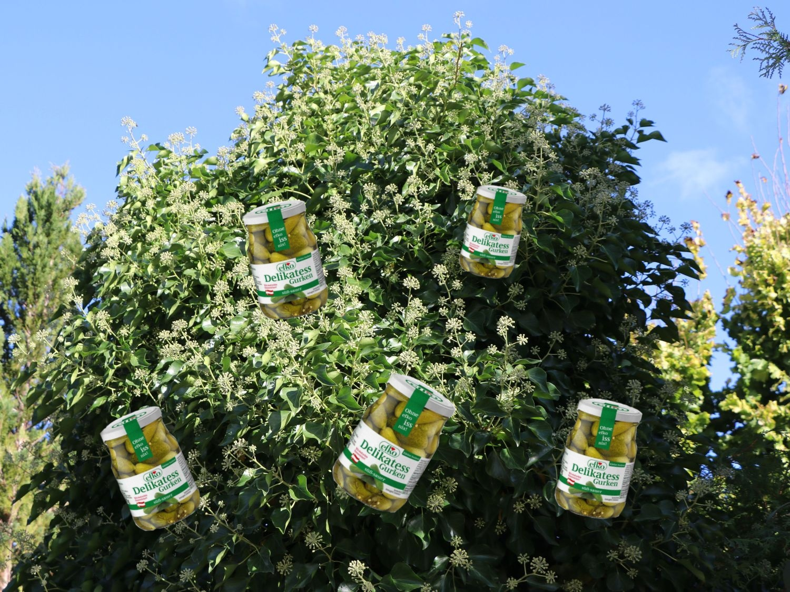

+++
title = 'Efkostaudn'
description = 'Eine natürlich gewachsene Efkostaude aus dem Eferdinger Becken.'
type = 'chapter'
weight = 30
+++

Eine natürlich gewachsene Efkostaude aus dem Eferdinger Becken.