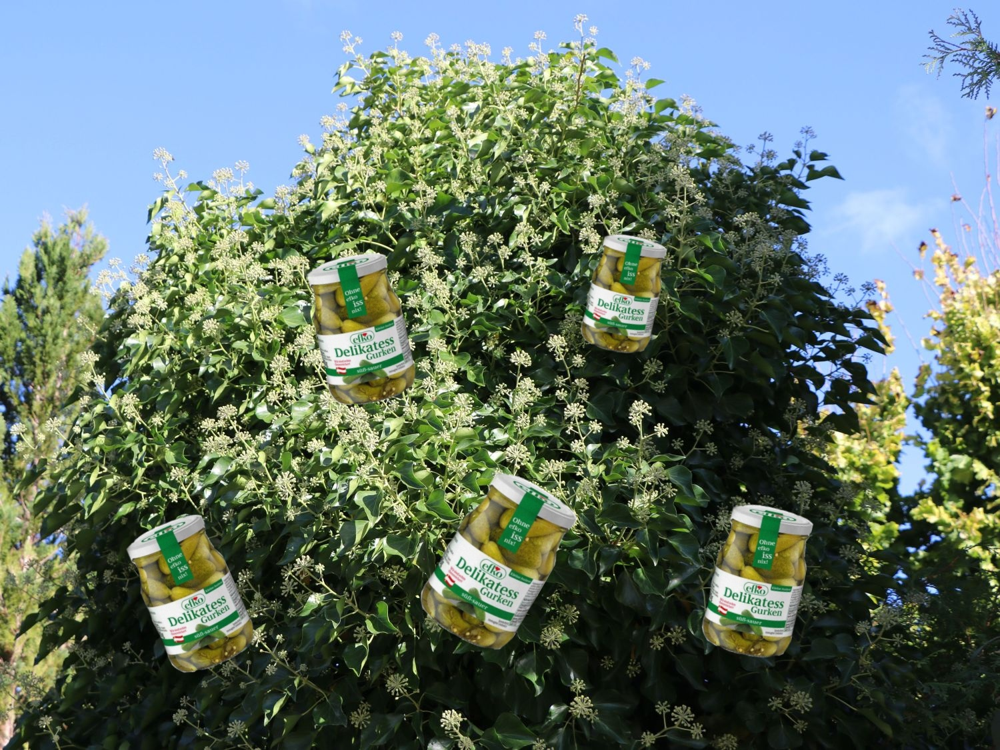

+++
title = 'Efkostaudn'
description = 'Eine natürlich gewachsene Efkostaude aus dem Eferdinger Becken.'
tags = ['Efko', 'Gurkerl']
+++

Eine natürlich gewachsene Efkostaude aus dem Eferdinger Becken.