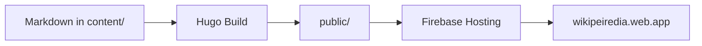

+++
title = 'Formatierung'
description = 'Hinweisboxen, Reiter, Diagramme und die übrigen Bausteine im Überblick.'
weight = 2
tags = ['markdown', 'referenz']
+++

# Formatierung

Neben normalem Markdown stehen die Bausteine des Relearn-Themes zur
Verfügung. Diese Seite zeigt die wichtigsten — sie ist bewusst als
Spickzettel gedacht.

## Hinweisboxen

{}
Neutraler Hinweis für Zusatzinformationen.
{}

{}
Etwas, das die Arbeit leichter macht.
{}

{}
Etwas, das schiefgehen kann.
{}

Geschrieben wird das so:

```markdown
{}
Etwas, das die Arbeit leichter macht.
{}
```

Verfügbare Werte für `style`: `info`, `note`, `tip`, `warning` sowie
Farbnamen wie `blue`, `green`, `red`, `cyan`.

## Reiter


{}
```bash
make dev
```
{}
{}
```powershell
hugo server -D
```
{}


## Ausklappbare Abschnitte

{}
Kein Server, der gewartet werden muss, keine Datenbank, die kaputtgehen
kann — und die Auslieferung über ein CDN ist schnell und günstig.
{}

## Diagramme

Diagramme entstehen aus Text ([Mermaid](https://mermaid.js.org/)) und
liegen damit ebenfalls versioniert im Git:



## Textauszeichnung

| Schreibweise | Ergebnis |
|---|---|
| `**fett**` | **fett** |
| `*kursiv*` | *kursiv* |
| `` `Code` `` | `Code` |
| `==markiert==` | ==markiert== |
| `++eingefügt++` | ++eingefügt++ |
| `~~gelöscht~~` | ~~gelöscht~~ |
| `H~2~O` | H~2~O |
| `x^2^` | x^2^ |

## Verweise auf andere Seiten

Interne Links werden mit `relref` gesetzt. Der Vorteil: Zeigt der Link ins
Leere, bricht der Build ab, statt einen toten Link zu veröffentlichen.

```markdown
[Einstieg]({})
```

Ergebnis: [Einstieg]({})

## Abbildungen

Bilder gehören neben die Seite, die sie verwendet (Page Bundle), oder
für Seitenübergreifendes nach `static/`:

```markdown

```

{}
Der Text in eckigen Klammern wird vorgelesen, wenn das Bild nicht
angezeigt werden kann. Er gehört zu jedem Bild dazu.
{}
